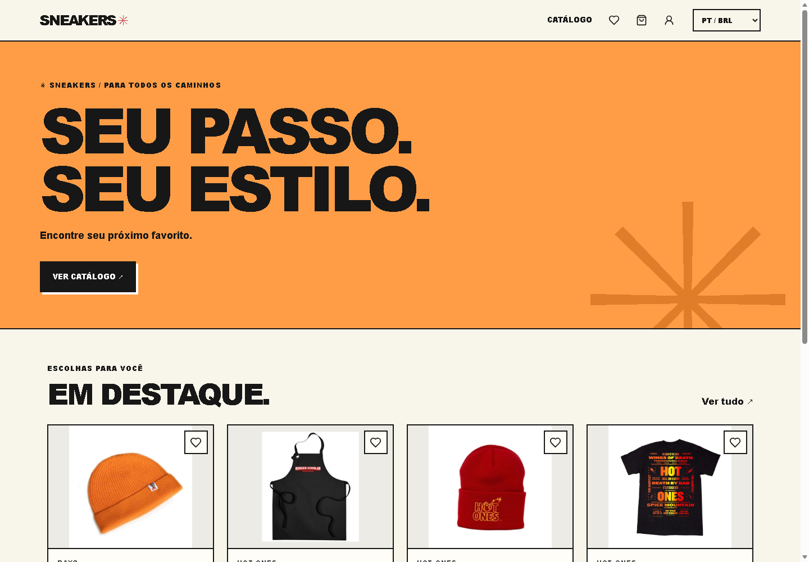
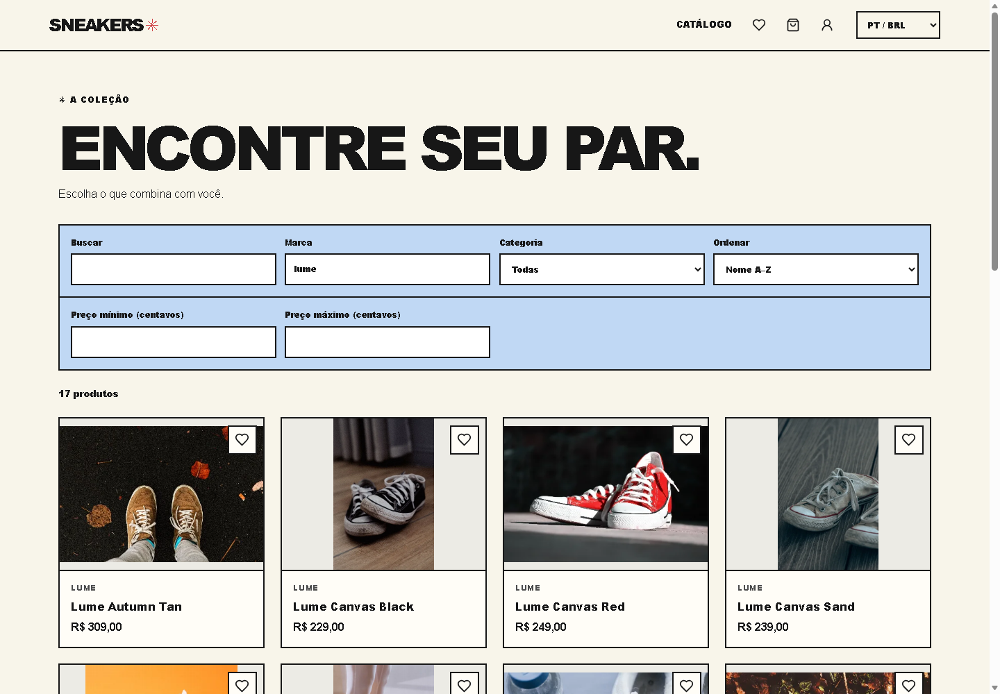

# Sneakers Store

Projeto de estudo independente, sem vínculo, associação ou endosso das marcas citadas.

Loja online em desenvolvimento com API Laravel e interface React. A API oferece autenticação, catálogo, carrinho, favoritos, endereços, checkout e histórico de pedidos. O frontend inclui cadastro, login, verificação de e-mail, recuperação de senha, Home, catálogo, produto, favoritos, carrinho, checkout e painel da conta com notificações.

## Screenshots

Capturas reais do site em português/BRL, com dados fictícios em um banco SQLite temporário. Desktop em 1440 × 1000 e celular em 390 × 844. A home mostra as imagens externas dos produtos como na execução local; a revisão da licença dessas imagens permanece pendente antes da publicação. As fotos locais dos calçados têm créditos em [CREDITS.md](CREDITS.md).





| Tela | Desktop | Celular |
| --- | --- | --- |
| Home | [Ver captura](docs/screenshots/home-desktop.png) | [Ver captura](docs/screenshots/home-mobile.png) |
| Catálogo Lume | [Ver captura](docs/screenshots/catalogo-desktop.png) | — |
| Produto | [Ver captura](docs/screenshots/produto-desktop.png) | [Ver captura](docs/screenshots/produto-mobile.png) |
| Login | [Ver captura](docs/screenshots/login-desktop.png) | — |
| Favoritos | [Ver captura](docs/screenshots/favoritos-desktop.png) | — |
| Carrinho | [Ver captura](docs/screenshots/carrinho-desktop.png) | — |
| Checkout: entrega | [Ver captura](docs/screenshots/checkout-entrega-desktop.png) | — |
| Checkout: pagamento | [Ver captura](docs/screenshots/checkout-pagamento-desktop.png) | — |
| Pedido confirmado | [Ver captura](docs/screenshots/pedido-confirmado-desktop.png) | — |
| Histórico de pedidos | [Ver captura](docs/screenshots/pedidos-desktop.png) | [Ver captura](docs/screenshots/pedidos-mobile.png) |
| Conta | [Ver captura](docs/screenshots/conta-desktop.png) | — |

## Estrutura e stack

- `sneakers-store-backend/`: PHP 8.4, Laravel 13, MySQL, Fortify, Sanctum e Pest.
- `sneakers-store-frontend/`: React 19, Vite Plus, React Router 7, TypeScript e Tailwind CSS 4.
- `docs/STATUS.md`: controle de progresso.
- `sneakers-store-frontend/starter/`: componentes de referência ainda não utilizados pela aplicação.

## Executar localmente

Requisitos: PHP com PDO MySQL, PDO SQLite e Intl; Composer; Node.js 22 ou superior; e MySQL.

### Projeto já configurado

Inicie o MySQL e, a partir da pasta raiz do projeto, abra dois terminais PowerShell. No primeiro, execute o backend:

```powershell
cd sneakers-store-backend
php artisan serve --host=localhost --port=8000
```

No segundo, execute o frontend:

```powershell
cd sneakers-store-frontend
npm.cmd run dev
```

Mantenha os dois terminais abertos e acesse `http://localhost:5173`. Crie uma conta em **Criar conta**, inicie o worker e confirme o e-mail recebido no Mailpit (ou no log) para testar favoritos, carrinho e checkout. Para encerrar cada servidor, pressione `Ctrl+C` no respectivo terminal.

Também é possível iniciar os serviços pela raiz, um comando em cada terminal: `npm.cmd run backend:serve` e `npm.cmd run dev`.

Se o projeto já tiver `.env`, banco e chave configurados, preserve-os: não copie novamente os arquivos de exemplo nem gere outra chave. O frontend usa `http://localhost:8000` como padrão do proxy quando `sneakers-store-frontend/.env` não existe.

### Primeira instalação

No PowerShell, para uma instalação nova:

```powershell
cd sneakers-store-backend
composer install
Copy-Item .env.example .env
php artisan key:generate
```

Crie um banco vazio chamado `sneakers_store` no MySQL e ajuste `DB_HOST`, `DB_PORT`, `DB_DATABASE`, `DB_USERNAME` e `DB_PASSWORD` em `sneakers-store-backend/.env`. Depois:

```powershell
php artisan migrate --seed --no-interaction
php artisan serve --host=localhost --port=8000
```

O seeder cadastra 30 produtos sem criar contas com senha padrão. Uma nova execução preserva produtos e preços já cadastrados. Execute os comandos de cópia e `key:generate` somente na primeira instalação, quando ainda não houver `.env` configurado.

Para substituir o catálogo antigo de calçados em um banco de desenvolvimento local já existente, execute dentro de `sneakers-store-backend/`:

```powershell
php artisan catalog:replace-footwear --no-interaction
```

O comando remove os calçados antigos e suas entradas em carrinhos e favoritos, mantendo os snapshots dos pedidos e os demais produtos. Ele adiciona os novos produtos sem sobrescrever edições existentes e não executa fora do ambiente local ou de teste. Faça backup do banco antes de executá-lo se precisar preservar os produtos antigos ou suas associações.

Se a troca do catálogo antigo já foi aplicada, adicione os novos produtos preservando os registros existentes:

```powershell
php artisan db:seed --class=ProductSeeder --no-interaction
```

Em outro terminal:

```powershell
cd sneakers-store-frontend
npm.cmd ci
Copy-Item .env.example .env
npm.cmd run dev
```

Abra `http://localhost:5173`. O Vite encaminha `/api` e `/sanctum` ao backend configurado em `VITE_API_URL`, cujo valor padrão é `http://localhost:8000`. Reinicie o Vite após alterar essa variável. Use `localhost` em ambos os serviços e configure `FRONTEND_URL` e `SANCTUM_STATEFUL_DOMAINS` no backend para o endereço do frontend. Em produção, configure um proxy da mesma origem para esses caminhos, cookies seguros e o domínio de sessão apropriado.

## Autenticação e interface

A autenticação usa sessão por cookie com [Sanctum SPA](https://laravel.com/docs/13.x/sanctum). O cliente obtém `/sanctum/csrf-cookie`, envia credenciais e inclui o token XSRF nas alterações. As páginas `/login` e `/register` permitem entrar ou criar conta; `/account` exige autenticação e reúne perfil, senha, endereços, favoritos e histórico de pedidos. Ao entrar depois de acessar uma rota protegida, o usuário retorna ao endereço solicitado.

O checkout em `/checkout` usa as etapas de carrinho, entrega, Wallet simulada e confirmação. Uma tentativa pendente mantém a chave de idempotência e os dados em `sessionStorage`, permitindo repetir a confirmação mesmo se a resposta se perder. O histórico apresenta os valores na moeda registrada pelo pedido.

O catálogo mantém busca, marca, categoria, faixa de preço, ordenação e paginação na URL. Favoritos e carrinho exigem autenticação; ao favoritar sem sessão, o usuário entra e retorna à página com o produto adicionado. O seletor no cabeçalho vincula inglês a USD e português brasileiro a BRL. A interface salva a preferência de idioma e envia `Accept-Language` à API. A base visual usa tokens de cores, bordas, sombras e espaçamento, com componentes reutilizáveis e foco visível.

## API

Os endpoints abaixo usam o prefixo `/api/v1`:

- `POST /auth/register`: name, email, password, password_confirmation, phone, birthday (YYYY-MM-DD), gender e second_contact opcional.
- `POST /auth/login` e `POST /auth/logout`: entrada e saída.
- `GET/PATCH/DELETE /user`: conta autenticada; exclusão exige password. `PUT /user/password` altera a senha.
- `GET /products` e `GET /products/{slug}`: catálogo público. A listagem aceita `brand`, `type`, `search`, `min_price`, `max_price`, `per_page` e `sort`; valores de filtro usam centavos.
- `GET /cart`, `POST /cart/items`, `PATCH/DELETE /cart/items/{id}` e `DELETE /cart`: carrinho autenticado, com quantidades de 1 a 999.
- `GET/POST /wishlist` e `DELETE /wishlist/{id}`: favoritos.
- `GET/POST /addresses`, `GET/PATCH/PUT/DELETE /addresses/{id}` e `PUT /addresses/{id}/default`: endereços. Cada usuário pode cadastrar até quatro e definir no máximo um como padrão.
- `GET /shipping-methods`: preços e prazos de frete na moeda selecionada.
- `POST /checkout`: recebe `address_id`, `shipping_method` e `payment_method`; exige o cabeçalho `Idempotency-Key` único de 16 a 64 caracteres alfanuméricos, hífen ou sublinhado. Repetir os mesmos dados e chave retorna o mesmo pedido; dados ou idioma diferentes retornam 409.
- `GET /orders` e `GET /orders/{id}`: histórico e detalhes dos pedidos da conta autenticada.
- `PATCH /user/locale`: salva `locale` (`en` ou `pt_BR`) da conta autenticada.
- `GET /notifications` e `GET /notifications/unread-count`: histórico paginado e quantidade de não lidas.
- `GET /notifications/{id}`, `PATCH /notifications/{id}/read` e `PATCH /notifications/read-all`: consulta e marcação restritas ao dono.
- `GET /auth/email/verify/{id}/{hash}`: confirmação via assinatura temporária; `POST /auth/email/verification-notification`: reenvio autenticado com rate limit.
- `POST /auth/forgot-password` e `POST /auth/reset-password`: solicitação e conclusão do reset com rate limit.

O servidor calcula valores e armazena snapshots de itens, endereço, moeda, subtotal, frete e total. A criação do pedido e a limpeza do carrinho ocorrem na mesma transação. O carrinho conserva o preço de adição na mesma moeda; ao trocar idioma/moeda, seus itens passam a usar os preços cadastrados para a nova moeda.

## Idiomas, preços e pagamento

- Inglês usa USD e formatação `en-US`; português usa BRL e formatação `pt-BR`. Os valores são armazenados em centavos inteiros.
- Os preços dos novos calçados foram definidos independentemente em USD e BRL. Os demais preços BRL de demonstração foram inicialmente definidos em 5× os valores USD e podem ser alterados independentemente. Não há cotação em tempo real.
- Os fretes BRL são **valores provisórios de demonstração** fixados inicialmente em 5× os valores USD, sem cotação em tempo real.
- Todos os métodos de pagamento são simulados. Na Wallet, o valor considerado é exatamente o total do pedido, sem desconto fictício de US$ 10, saldo financeiro ou integração com gateway.
- As descrições dos produtos possuem versões em inglês e português. Os dados do catálogo foram criados manualmente; os nomes e a marca Lume dos novos calçados são fictícios. O seeder preenche traduções ausentes sem sobrescrever textos e preços editados.
- As fotos dos calçados são arquivos locais; autores, fontes e licenças estão em [CREDITS.md](CREDITS.md). As imagens de roupas e acessórios continuam carregadas de `cdn.shopify.com` e não têm licença confirmada: devem ser substituídas antes de publicar o repositório ou fazer deploy.

## Fluxo de demonstração

1. Selecione português/BRL ou inglês/USD no cabeçalho e navegue pelo catálogo.
2. Crie uma conta, confirme o e-mail pelo link recebido, abra um produto e adicione itens ao carrinho ou aos favoritos.
3. No checkout, revise o carrinho, cadastre ou selecione um endereço e escolha o frete.
4. Confirme o pagamento simulado pela Wallet e consulte o pedido no painel da conta.

## Limites do projeto

- Pagamentos e fretes são demonstrações: não há cobrança real, gateway, cotação de transporte ou rastreamento integrado.
- Não há painel administrativo, controle quantitativo de estoque ou votação de avaliações; o rating é um dado estático do catálogo.
- A recuperação de senha tem telas React e envio em fila; a exclusão de conta permanece disponível apenas na API. Para entrega real de e-mails, configure SMTP e mantenha o worker ativo.
- Não foi feita importação de dados pessoais do MongoDB original. O seeder contém apenas produtos de demonstração.
- A publicação continua pendente da substituição das imagens externas de roupas e acessórios sem licença confirmada.


## E-mails, verificação e notificações

A loja envia boas-vindas, verificação de e-mail, recuperação de senha, aviso de senha alterada, confirmação de pedido e atualização de status. Os mesmos eventos aparecem no sino e no histórico em **Minha conta → Notificações**. O idioma do cadastro é salvo no usuário; o seletor atualiza a preferência para os próximos avisos, e a conta restaura esse idioma ao entrar.

**Nunca enviamos senhas por e-mail.** As boas-vindas informam nome e e-mail cadastrado. O acesso usa verificação de e-mail e redefinição de senha por links de curta duração.

Depois de atualizar um checkout existente, execute em `sneakers-store-backend/`:

```powershell
php artisan migrate --no-interaction
```

As duas migrations acrescentam o idioma do usuário e a tabela de notificações. Contas existentes recebem `en` como padrão; usuários sem e-mail verificado precisam confirmar o endereço antes de usar carrinho, favoritos, endereços e pedidos.

### Desenvolvimento com Mailpit

O padrão de desenvolvimento é `MAIL_MAILER=log`: o conteúdo dos e-mails fica em `sneakers-store-backend/storage/logs/laravel.log`, após o worker processar a fila. Para abrir os e-mails em uma caixa de entrada local, use [Mailpit](https://mailpit.axllent.org/docs/install/). Com Docker:

```powershell
docker run --rm --name sneakers-mailpit -p 127.0.0.1:8025:8025 -p 127.0.0.1:1025:1025 axllent/mailpit:v1.32.0
```

No Windows também é possível extrair o executável do [release oficial](https://github.com/axllent/mailpit/releases/tag/v1.32.0) e executá-lo na pasta extraída:

```powershell
.\mailpit.exe --listen 127.0.0.1:8025 --smtp 127.0.0.1:1025
```

Configure o `.env` local do backend:

```dotenv
MAIL_MAILER=smtp
MAIL_SCHEME=null
MAIL_HOST=127.0.0.1
MAIL_PORT=1025
MAIL_USERNAME=null
MAIL_PASSWORD=null
MAIL_URL=null
MAIL_TIMEOUT=15
MAIL_FROM_ADDRESS=store@example.test
MAIL_FROM_NAME="Sneakers"
QUEUE_CONNECTION=database
```

Depois de mudar o ambiente, execute `php artisan config:clear` e reinicie o backend e o worker. Acesse `http://127.0.0.1:8025` para ler os e-mails. O Mailpit captura as mensagens localmente; não precisa de credenciais de um provedor real.

### Worker obrigatório

Em um terminal separado, dentro do backend, mantenha:

```powershell
php artisan queue:work database --sleep=1 --tries=3 --timeout=30
```

As notificações usam explicitamente a conexão durável `database`, inclusive se outra funcionalidade usar outra conexão padrão. Os dois canais são processados depois do commit da transação. **Sem worker, e-mails e avisos internos ficam pendentes em jobs.** Não use `sync` para tentar contornar isso.

Para conferir falhas, execute `php artisan queue:failed`; após resolver a causa, use `php artisan queue:retry <uuid>`. Depois de publicar mudanças de código/configuração, use `php artisan queue:restart` e mantenha um gerenciador de processos responsável por reiniciar o worker em produção.

### SMTP em produção

Use as credenciais do seu provedor nas variáveis de ambiente do servidor, sem salvar valores reais no repositório. Exemplo para SMTP com TLS na porta 465:

```dotenv
APP_ENV=production
APP_DEBUG=false
APP_URL=https://api.sua-loja.example
FRONTEND_URL=https://sua-loja.example
MAIL_MAILER=smtp
MAIL_SCHEME=smtps
MAIL_HOST=smtp.seu-provedor.example
MAIL_PORT=465
MAIL_USERNAME=usuario-fornecido-pelo-provedor
MAIL_PASSWORD=segredo-definido-no-servidor
MAIL_URL=null
MAIL_EHLO_DOMAIN=sua-loja.example
MAIL_TIMEOUT=15
MAIL_FROM_ADDRESS=loja@sua-loja.example
MAIL_FROM_NAME="Sneakers"
QUEUE_CONNECTION=database
SESSION_SECURE_COOKIE=true
```

Ajuste origem de CORS, domínios stateful do Sanctum e domínio do cookie à hospedagem. O `.env.example` é um modelo sem credenciais reais. O worker deve usar o mesmo ambiente e a mesma `APP_KEY` da API, pois os jobs são criptografados.

### Links e limites

- Verificação: link assinado de 30 minutos, usado uma vez. Abre o React e confirma pela API mesmo se o usuário estiver deslogado; depois é preciso entrar para usar a conta. Reenvio autenticado: uma vez por minuto.
- Reset: telas `/forgot-password` e `/reset-password`; token de 15 minutos e uso único. Solicitação e confirmação limitadas a uma tentativa por e-mail/minuto e cinco por IP/minuto em cada endpoint.
- Mudança de e-mail invalida a verificação anterior e envia um novo link.
- O histórico usa paginação de 15 itens. O sino atualiza a cada 30 segundos com a aba visível e ao reabrir a aba; também permite marcar uma ou todas como lidas.
- Notificações de status são geradas quando uma instância de pedido muda de status via Eloquent. Não há painel administrativo nesta fase; atualizações em massa por SQL não disparam observers.

## Verificação

```powershell
cd sneakers-store-backend
php artisan test --compact
composer types:check
```

Os testes PHP usam SQLite em memória e não alteram o MySQL configurado. Para testar concorrência no MySQL de desenvolvimento com uma conta temporária, execute `python tests/Integration/mysql_concurrency.py` dentro de `sneakers-store-backend/`; o banco deve estar migrado e com o catálogo cadastrado.

```powershell
cd sneakers-store-frontend
npm.cmd test
npm.cmd run types:check
npm.cmd run check
npm.cmd run build
```
