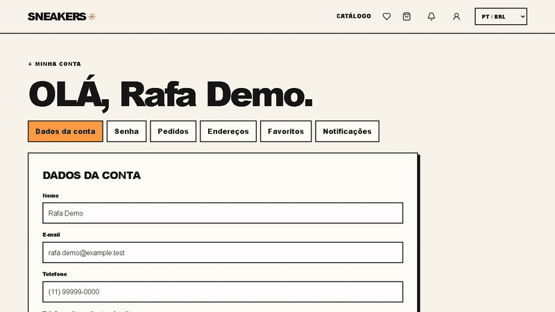

# Sneakers Store

A full-stack sneakers and apparel storefront built with a Laravel REST API and a React frontend. Browse the catalog, choose product options, save favorites and complete a simulated purchase, with English/USD and Brazilian Portuguese/BRL support.

**[Explore the demo](https://guilhermezalla.github.io/sneakers-store/)** · [Releases](https://github.com/GuilhermeZalla/sneakers-store/releases)

## Features

- Registration, login, email verification and password recovery.
- Product search, category/brand/price filters, sorting and pagination.
- Selectable sizes and colors, favorites and a cart that keeps product variants separate.
- Address book, shipping options, simulated checkout and order history.
- Customer reviews with editable scores/comments, average ratings and review counts.
- Account notifications with unread counts, individual removal and a clear-read action.
- Responsive layouts and language/currency switching.

## How it works

Authentication uses Sanctum cookie sessions and CSRF protection. The API validates product options, calculates prices on the server and saves order snapshots so later catalog changes do not alter past purchases. Idempotency prevents duplicate orders when checkout is retried.

Each account can publish one review per product and edit or remove it later. Ratings range from 1 to 5; the displayed score is the arithmetic mean, rounded to one decimal, alongside the review count. Products without reviews show an empty state. Reviews are customer opinions, not verified-purchase endorsements.

English uses USD and Brazilian Portuguese uses BRL. Prices are configured independently for each currency; there is no live exchange rate. Shipping and Wallet payments are simulated, and no money is charged.

## Public demo

The [GitHub Pages demo](https://guilhermezalla.github.io/sneakers-store/) runs entirely in the browser, without an API or database. The fictional account **Alex Demo** is ready to use: browse products, select sizes/colors, manage favorites and addresses, write reviews and place simulated orders. No registration, password, real payment or email delivery is involved. Use sample information only.

Changes last for the browser session. **Reset demo** restores the initial sample data. The bag shows the total item quantity, and the bell shows unread notifications. Adding a product creates an internal notice; read notices can be cleared without removing unread ones.

To run the demo locally, open a terminal at the repository root:

```powershell
cd sneakers-store-frontend
npm.cmd ci
npm.cmd run dev:demo
```

Open the URL printed by Vite, including `/sneakers-store/`. To generate the static demo, run `npm.cmd run build:demo`; the output is written to `dist/`. The demo uses hash routing for direct links on GitHub Pages.

The demo shares catalog, translations and shipping data with the backend source files, so keep both monorepo directories together. It does not access a live database or mirror changes made to a local database.

## Interface walkthroughs

Recorded demonstrations of the main shopping flows, using fictional data. For the current visual design, use the public demo.

### Store walkthrough


### Simulated purchase


### Account



### Mobile storefront


## Screenshots

Desktop and mobile views captured with fictional records. These screenshots and the walkthroughs above show the interface before the 1.0 visual refresh; explore the public demo for the current design.

| Page | Desktop | Mobile |
| --- | --- | --- |
| Home | [View](docs/screenshots/home-desktop.png) | [View](docs/screenshots/home-mobile.png) |
| Lume catalog | [View](docs/screenshots/catalogo-desktop.png) | — |
| Product | [View](docs/screenshots/produto-desktop.png) | [View](docs/screenshots/produto-mobile.png) |
| Login | [View](docs/screenshots/login-desktop.png) | — |
| Favorites | [View](docs/screenshots/favoritos-desktop.png) | — |
| Cart | [View](docs/screenshots/carrinho-desktop.png) | — |
| Delivery | [View](docs/screenshots/checkout-entrega-desktop.png) | — |
| Payment | [View](docs/screenshots/checkout-pagamento-desktop.png) | — |
| Order confirmation | [View](docs/screenshots/pedido-confirmado-desktop.png) | — |
| Order history | [View](docs/screenshots/pedidos-desktop.png) | [View](docs/screenshots/pedidos-mobile.png) |
| Account | [View](docs/screenshots/conta-desktop.png) | — |

## Stack and structure

- `sneakers-store-backend/`: PHP, Laravel, MySQL, Fortify, Sanctum and Pest.
- `sneakers-store-frontend/`: React, TypeScript, React Router, Tailwind CSS and Vite Plus.

## Run the full application locally

### Requirements

- PHP 8.4 with PDO MySQL, PDO SQLite, Intl and the extensions required by Composer.
- Composer 2 and MySQL 8.
- Node.js 24.15.0, pinned in `.nvmrc`.
- Optionally, Mailpit to inspect development emails in a local inbox.

### 1. Install the backend

From the repository root:

```powershell
cd sneakers-store-backend
composer install
Copy-Item .env.example .env
php artisan key:generate
```

Create an empty MySQL database named `sneakers_store`. Configure `DB_HOST`, `DB_PORT`, `DB_DATABASE`, `DB_USERNAME` and `DB_PASSWORD` in the backend `.env` using your local credentials.

Keep these application URLs consistent:

```dotenv
APP_URL=http://localhost:8000
FRONTEND_URL=http://localhost:5173
SANCTUM_STATEFUL_DOMAINS=localhost:5173,localhost:8000
```

Apply the migrations, load the sample catalog and start the API:

```powershell
php artisan migrate --seed --no-interaction
php artisan serve --host=localhost --port=8000
```

The seeder adds 30 products without creating accounts with default passwords. Keep this terminal open.

### 2. Install the frontend

Open another terminal at the repository root:

```powershell
cd sneakers-store-frontend
npm.cmd ci
Copy-Item .env.example .env
npm.cmd run dev
```

Visit `http://localhost:5173`. Vite forwards API requests to `VITE_API_URL`, which defaults to `http://localhost:8000`. Use `localhost` for both services and restart Vite after changing its environment settings.

### 3. Start the queue worker

Open a third terminal at the repository root:

```powershell
cd sneakers-store-backend
php artisan queue:work database --sleep=1 --tries=3 --timeout=30
```

Keep the worker running for email verification, password recovery and queued order/account notifications. Development defaults to `MAIL_MAILER=log`: after the worker processes a message, its content appears in `sneakers-store-backend/storage/logs/laravel.log`. See the Mailpit setup below for a local inbox.

### 4. Try the shopping flow

1. Register and confirm your email using the message captured in the log or Mailpit.
2. Select a product's available size and color, then add it to the bag or use **Buy now**.
3. Review the cart, add an address and choose a shipping option.
4. Complete the simulated Wallet payment and view the order in your account.

Verified accounts can also save favorites and publish product reviews. The public demo skips registration and verification because it uses a fictional account.

### Subsequent runs and updates

For an already configured installation, start MySQL and run these commands in separate terminals from the repository root:

```powershell
npm.cmd run backend:serve
```

```powershell
npm.cmd run dev
```

Also start the queue worker shown above. Press `Ctrl+C` in each terminal to stop its process.

Preserve your existing `.env`, application key and database. After pulling updates, install dependencies as needed and apply pending migrations from the backend directory:

```powershell
php artisan migrate --no-interaction
```

After changing backend environment settings, run `php artisan config:clear` and restart the API and worker.

### Optional local inbox with Mailpit

Run [Mailpit](https://mailpit.axllent.org/docs/install/), for example with Docker:

```powershell
docker run --rm --name sneakers-mailpit -p 127.0.0.1:8025:8025 -p 127.0.0.1:1025:1025 axllent/mailpit:v1.32.0
```

Set the following values in the backend `.env`:

```dotenv
MAIL_MAILER=smtp
MAIL_SCHEME=null
MAIL_HOST=127.0.0.1
MAIL_PORT=1025
MAIL_USERNAME=null
MAIL_PASSWORD=null
MAIL_URL=null
MAIL_FROM_ADDRESS=store@example.test
MAIL_FROM_NAME="Sneakers"
QUEUE_CONNECTION=database
```

Clear cached configuration and restart the API and worker. Open `http://127.0.0.1:8025` to read captured messages. Mailpit does not deliver real emails; external delivery requires an SMTP provider.

### Windows PHP startup troubleshooting

If `artisan serve` fails with `SplFileInfo` or `Class "view" does not exist` while OPcache is enabled, stop it and run this alternative from the backend directory:

```powershell
php -d opcache.enable=0 -S localhost:8000 -t public public/index.php
```

This disables OPcache only for that process.

## Tests and builds

Backend, from `sneakers-store-backend/`:

```powershell
php artisan test --compact
composer types:check
```

The PHP suite uses SQLite in memory and does not modify the configured MySQL database.

Frontend, from `sneakers-store-frontend/`:

```powershell
npm.cmd test
npm.cmd run types:check
npm.cmd run check
npm.cmd run build
npm.cmd run build:demo
```

Frontend tests include demo behavior, checkout, product reviews/options and notifications. Browser tests require Chrome, Chromium or Edge; set `BROWSER_PATH` if needed. `build` generates the API-connected frontend, while `build:demo` generates the standalone public demonstration.

## Scope and future work

- **Full-system hosting:** the Laravel API, MySQL and queue workers are not publicly hosted. The standalone frontend demo is available on GitHub Pages.
- **Real payments:** checkout currently simulates payment; gateway integration remains future work.
- Shipping is simulated, without live quotes or tracking integration.
- There is no administration panel, quantitative stock control or review moderation/reporting interface.
- Account deletion is available through the API only.

## License and credits

An independent portfolio project, with no affiliation, association or endorsement from the brands mentioned. This version reimplements the [original MERN project (2022)](https://github.com/GuilhermeZalla/sneakers).

Code is available under the [MIT license](LICENSE). Product images have separate terms and source credits documented in [CREDITS.md](CREDITS.md).
