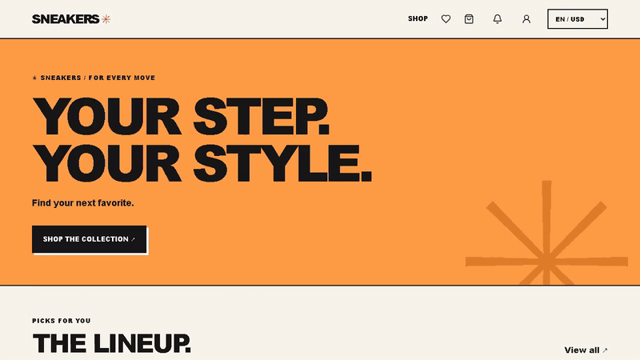
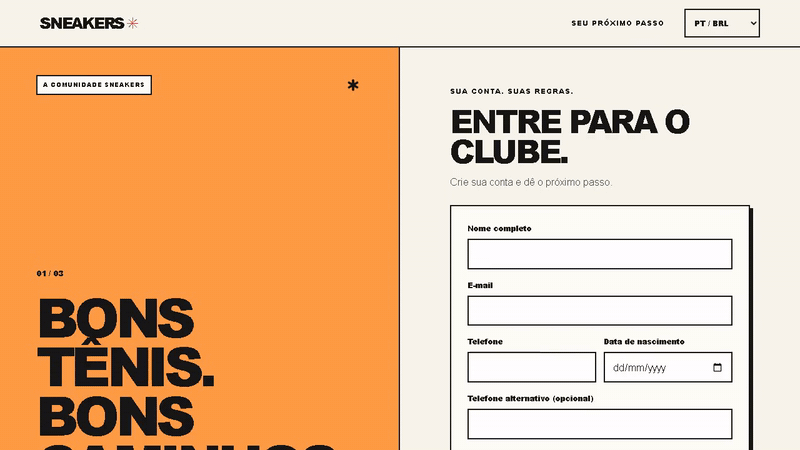
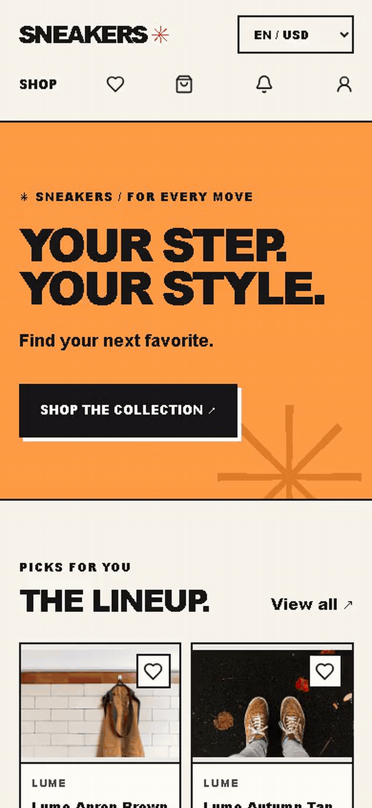

# Sneakers Store

An independent portfolio project, with no affiliation, association or endorsement from the brands mentioned.

This version reimplements the [original MERN project (2022)](https://github.com/GuilhermeZalla/sneakers). Code is available under the [MIT license](LICENSE). Images have their own terms, documented in [CREDITS.md](CREDITS.md). Lume Beanie Orange and Lume Beanie Red use images generated with OpenAI image_gen; the remaining catalog photographs come from Pexels and are credited individually.

A full-stack storefront built with a Laravel REST API and a React frontend. It includes registration, login, email verification, password recovery, a filterable product catalog, favorites, cart, addresses, simulated checkout, order history and account notifications. English/USD and Brazilian Portuguese/BRL are supported.

## Public demo

**[Explore the demo](https://guilhermezalla.github.io/sneakers-store/)** · [Releases](https://github.com/GuilhermeZalla/sneakers-store/releases)

The GitHub Pages demo runs entirely in the browser, without an API or database. The sample account, Alex Demo, is ready to use. Browse products, search and filter the catalog, save favorites, edit sample addresses and place simulated orders. No registration, password, real payment or email delivery is involved. Use sample information only.

Changes last for the browser session. **Reset demo** restores the initial sample data. Invalid or outdated stored data safely falls back to a fresh session. The bag shows the total item quantity; the bell shows unread notifications. Adding a product creates an internal notice immediately. Notices can be marked as read, removed individually or cleared in bulk using **Clear read notifications**, which preserves unread items.

```powershell
cd sneakers-store-frontend
npm ci
npm run dev:demo
```

Open the URL printed by Vite, including `/sneakers-store/`. `npm run build:demo` creates the static demo in `dist/`; `npm run build` creates the API-connected frontend. The demo uses hash routing so direct links work on GitHub Pages. The workflow publishes the demo after the checks on `main` pass.

The demo imports the public seed catalog, translations and shipping data directly from the backend source files. It does not read a live database or use private environment variables. Custom database changes are not mirrored into the demo. Keep the monorepo directories together when building it.

Full-system hosting and real payment integration remain future work.

## Portfolio covers

Real Home screenshots presented as a responsive website, with editorial browser frames:

- [1920 × 1320 cover, 16:11](docs/portfolio/sneakers-portfolio-cover.svg)
- [1920 × 1080 cover, 16:9](docs/portfolio/sneakers-home.svg)
- Original captures: [desktop](docs/portfolio/sneakers-desktop.jpg) and [mobile](docs/portfolio/sneakers-mobile.jpg).

The screenshots and recordings below document the interface before the 1.0 visual refresh. The covers above show the refreshed Home. Recordings use fictional data in an isolated temporary database; Wallet payments do not charge real money.

### Store walkthrough



### Simulated purchase



### Account


### Mobile storefront



## Screenshots

Captured in Portuguese/BRL using fictional records in a temporary SQLite database: 1440 × 1000 desktop and 390 × 844 mobile. The catalog contains 30 products with local WebP images; authors, sources and licenses are in [CREDITS.md](CREDITS.md).

| Page | Desktop | Mobile |
| --- | --- | --- |
| Home | [View](docs/screenshots/home-desktop.png) | [View](docs/screenshots/home-mobile.png) |
| Lume catalog | [View](docs/screenshots/catalogo-desktop.png) | — |
| Product | [View](docs/screenshots/produto-desktop.png) | [View](docs/screenshots/produto-mobile.png) |
| Login | [View](docs/screenshots/login-desktop.png) | — |
| Favorites | [View](docs/screenshots/favoritos-desktop.png) | — |
| Cart | [View](docs/screenshots/carrinho-desktop.png) | — |
| Delivery | [View](docs/screenshots/checkout-entrega-desktop.png) | — |
| Payment | [View](docs/screenshots/checkout-pagamento-desktop.png) | — |
| Order confirmation | [View](docs/screenshots/pedido-confirmado-desktop.png) | — |
| Order history | [View](docs/screenshots/pedidos-desktop.png) | [View](docs/screenshots/pedidos-mobile.png) |
| Account | [View](docs/screenshots/conta-desktop.png) | — |

## Structure and stack

- `sneakers-store-backend/`: PHP 8.4, Laravel 13, MySQL, Fortify, Sanctum and Pest.
- `sneakers-store-frontend/`: React 19, Vite Plus, React Router 7, TypeScript and Tailwind CSS 4.
- `docs/STATUS.md`: internal progress and remaining work.

## Local development

Requirements: PHP 8.4 with PDO MySQL, PDO SQLite, Intl and the extensions required by Composer; Composer 2; MySQL 8; and Node.js 24.15.0, pinned in `.nvmrc`. Vite Plus supports `^22.18.0 || ^24.11.0 || >=26.0.0`; use the pinned version to reproduce the checks. Browser tests require Chrome, Chromium or Edge. Set `BROWSER_PATH` to specify an executable.

### An already configured checkout

Start MySQL. Open two PowerShell terminals from the repository root. Run the API in the first:

```powershell
cd sneakers-store-backend
php artisan serve --host=localhost --port=8000
```

Run the frontend in the second:

```powershell
cd sneakers-store-frontend
npm.cmd run dev
```

Keep both terminals open and visit `http://localhost:5173`. Create an account, start the queue worker and verify the email received through Mailpit or the log before using favorites, cart, addresses and checkout. Press `Ctrl+C` in each terminal to stop its server.

Alternatively, from the repository root, run `npm.cmd run backend:serve` and `npm.cmd run dev` in separate terminals.

Preserve an existing `.env`, application key and database. Do not copy example files or generate another key for a configured installation. The frontend proxy defaults to `http://localhost:8000` when its `.env` is absent.

### Windows OPcache startup issue

During validation with Herd PHP 8.4.27, the built-in server failed with `SplFileInfo` / `Class "view" does not exist` while OPcache was enabled. If this occurs, stop `artisan serve` and run the following inside the backend. It disables OPcache for that process only:

```powershell
php -d opcache.enable=0 -S localhost:8000 -t public public/index.php
```

Keep this port consistent with `APP_URL` and `VITE_API_URL`. The MySQL concurrency script already disables OPcache in its temporary servers and sets its own Sanctum domains.

### First installation

For a new installation only:

```powershell
cd sneakers-store-backend
composer install
Copy-Item .env.example .env
php artisan key:generate
```

Create an empty `sneakers_store` MySQL database and privately configure `DB_HOST`, `DB_PORT`, `DB_DATABASE`, `DB_USERNAME` and `DB_PASSWORD` in the backend `.env`. For a disposable installation check, use the isolated database procedure below instead of your regular database. Then:

```powershell
php artisan migrate --seed --no-interaction
php artisan serve --host=localhost --port=8000
```

The seeder adds 30 products, without creating accounts with default passwords. Running it again preserves existing products and prices. The predictable password in `UserFactory` is for tests only; never use it to create real accounts. The integration fixture replaces it with a random secret and refuses non-test databases.

In another terminal:

```powershell
cd sneakers-store-frontend
npm.cmd ci
Copy-Item .env.example .env
npm.cmd run dev
```

Visit `http://localhost:5173`. Vite forwards `/api` and `/sanctum` to `VITE_API_URL`, defaulting to `http://localhost:8000`. Restart Vite after changing this value. Use `localhost` for both services, and configure `FRONTEND_URL` and `SANCTUM_STATEFUL_DOMAINS` accordingly. Production hosting needs a same-origin proxy for these paths, secure cookies and the appropriate session domain.

### Existing catalog maintenance

To replace the legacy footwear in an existing local development database:

```powershell
cd sneakers-store-backend
php artisan catalog:replace-footwear --no-interaction
```

This removes legacy footwear and its cart/favorite entries while retaining order snapshots and other products. It adds the new products without overwriting existing edits and refuses non-local/non-test environments. Back up your database before using it if you need the old products or associations.

If replacement has already been completed, add missing seed products without replacing existing records:

```powershell
php artisan db:seed --class=ProductSeeder --no-interaction
```

To update the 13 legacy apparel/accessory images and descriptions:

```powershell
php artisan catalog:refresh-apparel
```

This local/test-only command requires a local connection. It updates names, brands, descriptions, colors and images for `legacy_id` 51–63 in one transaction. It preserves IDs, existing slugs, prices, sizes, ratings, cart/favorite associations and order snapshots. It creates or deletes no products. Repeating it reapplies the sample catalog texts and photos. `migrate:fresh` is not needed.

## Authentication and interface

Authentication uses server-side cookie sessions with [Sanctum SPA](https://laravel.com/docs/13.x/sanctum). The client initializes `/sanctum/csrf-cookie`, sends credentials and includes the XSRF token in mutations. `/login` and `/register` handle access; `/account` contains profile, password, addresses, favorites, order history and notifications. Login returns users to the protected page they originally requested.

Checkout follows cart, delivery, simulated Wallet payment and confirmation. Pending attempts retain their idempotency key and payload in `sessionStorage`, so a lost response can be retried. Order history displays the currency saved with each order.

Catalog search, brand, category, price range, sorting and pagination are kept in the URL. Price inputs show currency units; the API receives integer cents. Saving a favorite while signed out redirects through login and returns to the product. The language selector pairs English with USD and Brazilian Portuguese with BRL and sends `Accept-Language` to the API.

The interface uses shared color, border, spacing and shadow tokens, visible keyboard focus, responsive layouts and subtle interaction feedback. The approved reduced-motion variant uses a smaller lift for cards/buttons and disables image zoom and entrance animations.

## API

All endpoints below use `/api/v1`:

- `POST /auth/register`: `name`, `email`, `password`, `password_confirmation`, `phone`, `birthday` (`YYYY-MM-DD`), `gender` and optional `second_contact`.
- `POST /auth/login`, `POST /auth/logout`: sign in/out.
- `GET/PATCH/DELETE /user`: the authenticated account; deletion requires `password`. `PUT /user/password` changes the password.
- `GET /products`, `GET /products/{slug}`: public catalog. Filters: `brand`, `type`, `search`, `min_price`, `max_price`, `per_page`, `sort`. API prices use cents.
- `GET /cart`, `POST /cart/items`, `PATCH/DELETE /cart/items/{id}`, `DELETE /cart`: authenticated cart; quantities range from 1 to 999.
- `GET/POST /wishlist`, `DELETE /wishlist/{id}`: favorites.
- `GET/POST /addresses`, `GET/PATCH/PUT/DELETE /addresses/{id}`, `PUT /addresses/{id}/default`: at most four addresses per account, with at most one default.
- `GET /shipping-methods`: fixed shipping prices and estimates in the selected currency.
- `POST /checkout`: `address_id`, `shipping_method`, `payment_method`; requires a 16–64 character alphanumeric/hyphen/underscore `Idempotency-Key`. Repeating the same key and data returns the same order; different data or language returns 409.
- `GET /orders`, `GET /orders/{id}`: the account's orders.
- `PATCH /user/locale`: saves `en` or `pt_BR` for the authenticated account.
- `GET /notifications`, `GET /notifications/unread-count`: paginated history and unread count.
- `GET /notifications/{id}`, `PATCH /notifications/{id}/read`, `PATCH /notifications/read-all`: owner-scoped retrieval and read state.
- `DELETE /notifications/{id}`: remove one owned notification.
- `DELETE /notifications/read`: remove only the authenticated account's read notifications. Unread notifications and other accounts' records are preserved.
- `GET /auth/email/verify/{id}/{hash}`: temporary signed verification link.
- `POST /auth/email/verification-notification`: authenticated, rate-limited resend.
- `POST /auth/forgot-password`, `POST /auth/reset-password`: rate-limited password recovery.

The server calculates totals and saves item/address/currency/subtotal/shipping snapshots. Order creation and cart clearing share one transaction. Cart prices remain at their addition snapshot within the same currency; changing language/currency synchronizes items to the configured price for that currency.

## Languages, prices and payment

- English uses USD/`en-US`; Portuguese uses BRL/`pt-BR`. Money is stored as integer cents.
- Footwear USD and BRL prices were defined independently. Other initial demonstration BRL prices were set to five times USD and can be edited independently. There is no live exchange rate.
- BRL shipping prices are provisional demonstration amounts initially set at five times USD, without live conversion. API and demo share the versioned shipping table.
- All payments are simulated. Wallet uses the full order amount, with no fictitious $10 discount, financial balance or gateway.
- Product descriptions are bilingual. Lume names/branding are fictional; the seeder fills missing translations without overwriting edited texts or prices.
- All product images are local WebP files, with 400 px thumbnails and larger versions. Home/catalog/product views do not depend on image CDNs.

## Shopping walkthrough

For the full local application:

1. Choose Portuguese/BRL or English/USD and explore the catalog.
2. Register, verify the email, then add products to the cart or favorites.
3. Review the cart, create/select an address and choose shipping.
4. Confirm the simulated Wallet purchase and open the order in your account.

The public demo uses the ready-made fictional account and needs no email verification.

## Email, verification and notifications

Welcome, verification, password recovery, password-change security, order confirmation and order-status messages use Laravel Notifications. Transactional email and database delivery use the durable database queue, after commit. The saved account language controls future messages and is restored on login. Passwords are never emailed; access uses short-lived verification/reset links.

Cart-addition notices are **internal only**. They are stored immediately inside the cart transaction and do not send email or require a queue worker. After a successful addition, the frontend refreshes the bell immediately in both the demo and the API-connected application. Failed additions create no notice. Excluding or clearing notifications checks ownership on the server.

Older installations may need the existing locale/notifications migrations:

```powershell
cd sneakers-store-backend
php artisan migrate --no-interaction
```

The notification controls added after 1.0 require no new migrations. Existing users default to English; unverified accounts must confirm their email before using shopping operations.

### Mailpit for development

Development defaults to `MAIL_MAILER=log`; queued email appears in `storage/logs/laravel.log` after the worker processes it. To inspect a local inbox, use [Mailpit](https://mailpit.axllent.org/docs/install/). With Docker:

```powershell
docker run --rm --name sneakers-mailpit -p 127.0.0.1:8025:8025 -p 127.0.0.1:1025:1025 axllent/mailpit:v1.32.0
```

Alternatively, extract the [official Windows release](https://github.com/axllent/mailpit/releases/tag/v1.32.0) and run:

```powershell
.\mailpit.exe --listen 127.0.0.1:8025 --smtp 127.0.0.1:1025
```

Backend `.env`:

```dotenv
MAIL_MAILER=smtp
MAIL_SCHEME=null
MAIL_HOST=127.0.0.1
MAIL_PORT=1025
MAIL_USERNAME=null
MAIL_PASSWORD=null
MAIL_URL=null
MAIL_TIMEOUT=15
MAIL_FROM_ADDRESS=store@example.test
MAIL_FROM_NAME="Sneakers"
QUEUE_CONNECTION=database
```

After changing environment settings, run `php artisan config:clear` and restart the API and worker. Read captured mail at `http://127.0.0.1:8025`; provider credentials are unnecessary for Mailpit.

### Required queue worker

Inside the backend, keep a separate terminal running:

```powershell
php artisan queue:work database --sleep=1 --tries=3 --timeout=30
```

Queued transactional notifications explicitly use the `database` connection even if another default is configured. **Without a worker, queued email and database notifications remain in jobs.** Do not switch to `sync` to work around missing workers. Cart-addition notices are the immediate internal exception described above.

Inspect failed jobs with `php artisan queue:failed`. Fix the cause before `php artisan queue:retry <uuid>`. After deploying code/configuration, use `php artisan queue:restart` and a process manager to restart the worker.

### Production SMTP

Set provider credentials in the server environment, never in committed files. Example for TLS on port 465:

```dotenv
APP_ENV=production
APP_DEBUG=false
APP_URL=https://api.your-store.example
FRONTEND_URL=https://your-store.example
MAIL_MAILER=smtp
MAIL_SCHEME=smtps
MAIL_HOST=smtp.your-provider.example
MAIL_PORT=465
MAIL_USERNAME=provider-supplied-user
MAIL_PASSWORD=server-configured-secret
MAIL_URL=null
MAIL_EHLO_DOMAIN=your-store.example
MAIL_TIMEOUT=15
MAIL_FROM_ADDRESS=store@your-store.example
MAIL_FROM_NAME="Sneakers"
QUEUE_CONNECTION=database
SESSION_SECURE_COOKIE=true
```

Adjust CORS, Sanctum stateful domains and session cookie settings to your hosting. `.env.example` contains placeholders. The worker must use the same environment and `APP_KEY` as the API because queued jobs are encrypted.

### Link lifetimes and rate limits

- Verification links are signed, valid for 30 minutes and single-use. React confirms through the API even when signed out; login is still required afterward. Registration, email changes and resends share five attempts per IP/minute; profile/resend delivery also shares one attempt per user/minute. Initial registration starts that user quota; unrelated profile changes do not consume it.
- Password recovery returns the same status/body for existing and unknown emails. `/forgot-password` and `/reset-password` use 15-minute, single-use tokens. Each endpoint allows one attempt per email/minute and five per IP/minute.
- Changing the account email invalidates verification and sends a new link.
- Notifications are paginated in groups of 15. Polling runs every 30 seconds while the tab is visible and refreshes on tab visibility changes. Read, remove and clear-read actions update the list and count; deleting the last item of a page returns to a valid page.
- Order-status notices are triggered by Eloquent model updates. There is no administration interface; bulk SQL updates do not trigger observers.

## Verification

```powershell
cd sneakers-store-backend
php artisan test --compact
composer types:check
```

PHP tests force SQLite in memory and do not modify the configured MySQL database. Frontend tests mount the notification/store providers in Chrome/Edge with controlled HTTP responses: keyboard/focus, visibility polling, immediate cart feedback, read/delete controls, error/retry, account changes, logout and late responses. Demo tests cover storage validation, currency, default addresses, idempotency and notification removal.

```powershell
cd sneakers-store-frontend
npm.cmd test
npm.cmd run types:check
npm.cmd run check
npm.cmd run build
npm.cmd run build:demo
```

### Isolated MySQL concurrency check

Requires Python 3.10+ (standard library only) and the `mysql` client on PATH. Open a **new terminal** so these variables do not affect your regular services. Inside the backend, create only a disposable database:

```powershell
$integrationDatabase = 'sneakers_test_' + [guid]::NewGuid().ToString('N')
mysql --host=127.0.0.1 --user=root --execute="CREATE DATABASE $integrationDatabase CHARACTER SET utf8mb4 COLLATE utf8mb4_unicode_ci;"
if ($LASTEXITCODE -ne 0) { throw 'Could not create the isolated database' }
$env:APP_ENV='testing'
$env:DB_CONNECTION='mysql'
$env:DB_HOST='127.0.0.1'
$env:DB_DATABASE=$integrationDatabase
$env:DB_URL=''
$env:CACHE_STORE='database'
$env:SESSION_DRIVER='database'
$env:MAIL_MAILER='log'
php artisan config:clear
php artisan migrate --seed --no-interaction
python tests/Integration/mysql_concurrency.py
```

Privately set `DB_USERNAME` and `DB_PASSWORD`. Never commit credentials. Use `mysql --password` for an interactive password prompt. If `php` is not the PHP 8.4 executable, set `$env:PHP_BINARY='C:/path/to/php.exe'` before running Python.

The script inspects the effective Laravel configuration first: testing environment, MySQL driver, local host and a database named `sneakers_test_` followed by 12–32 hexadecimal characters. It creates an already verified temporary user with a random password received through stdin and removes it in `finally`. It refuses the regular `sneakers_store` database. Ten concurrent pairs test default-address changes and idempotent checkout; no real emails are sent.

For a full installation check, use the same isolated database for the setup steps, Mailpit and worker. Replicate the variables in each new terminal, use different ports from your regular services and keep `APP_URL`, `FRONTEND_URL`, `SANCTUM_STATEFUL_DOMAINS` and `VITE_API_URL` consistent. After stopping all temporary services, remove **only** the disposable database:

```powershell
if ($integrationDatabase -notmatch '^sneakers_test_[a-f0-9]{32}$') { throw 'Unexpected database name' }
mysql --host=127.0.0.1 --user=root --execute="DROP DATABASE $integrationDatabase;"
```

## Technical decisions

- Cookie-based Sanctum SPA authentication, CSRF protection and one HTTP client; React Router owns frontend navigation.
- Transactional checkout, snapshots and cart clearing with a user-row lock.
- Per-user idempotency keys and request fingerprints prevent duplicate or incompatible retries.
- Order snapshots retain names, prices, currency and delivery address independently of later catalog/profile edits.
- Integer cents and fixed, independently editable USD/BRL prices; no live exchange rate.
- Durable encrypted after-commit email jobs, with a separate worker.
- Owner-scoped notifications and visible-tab polling without WebSockets; immediate internal cart notices.
- One approved visual theme with reusable interface components.

## Scope and future work

- **Pending: full-system hosting** for the frontend, Laravel API, MySQL and queue workers. The public frontend demo is already hosted on GitHub Pages.
- **Pending: real payments**, including a selected gateway, sandbox checks, signed webhooks, idempotency, declined/pending/canceled/refunded states and payment confirmation before marking an order paid.
- Shipping is simulated; there is no live quote or tracking integration.
- There is no administration panel, quantitative stock control or customer rating system. Catalog ratings are static sample data.
- Password recovery has React screens and queued delivery. Account deletion is API-only. Real mail requires configured SMTP and a running worker.
- No personal data was imported from the original MongoDB project. The seeder contains demonstration products only.

### Git history maintenance

Two historical screenshot blobs with unconfirmed image licensing were removed from public branches and tags. The current application files, approved images and v1.0.0 release tree were preserved. A complete pre-cleanup mirror backup is kept locally outside the repository. If you have an older clone, clone the repository again or realign it before pushing to avoid restoring the removed history. Local agent checkpoints and backup mirrors are not published.
